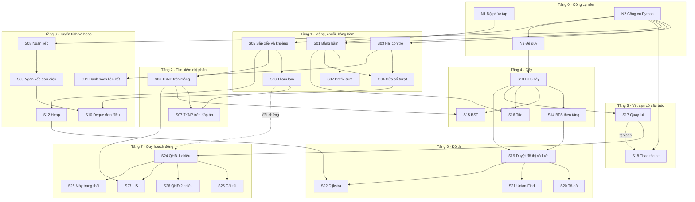

# PHẦN 2 — BẢN ĐỒ KIẾN THỨC DSA

> Phần 2/5 của lộ trình DSA 7 ngày, xây trên [Phần 1 – Cơ sở khoa học](01_Co_so_khoa_hoc.md).
> Dữ liệu: 3.711 bài DSA trong file Excel của repo, ghép với **nhãn chủ đề LeetCode** và **điểm rating độ khó** (tính từ kết quả
> các kỳ thi) lấy từ kho công khai [doocs/leetcode](https://github.com/doocs/leetcode). Bảng dữ liệu đã ghép:
> [data/dsa_3711_chu_de_rating.csv](data/dsa_3711_chu_de_rating.csv). Cách tái tạo ở mục 12.

---

## 0. Tóm tắt

1. **Bản đồ gồm 28 schema (khuôn mẫu tư duy), xếp thành 8 tầng, cộng 3 công cụ nền.** Con số này nằm trong ngân sách 25–30
   schema đã đặt ở Phần 1.
2. **Độ bao phủ đo bằng dữ liệu.** Trong số bài có nhãn, 28 schema này chứa đủ mọi kỹ thuật được gắn nhãn của **94% bài Easy,
   89% bài Medium và 68,5% bài Hard**. Đây là *phạm vi kiến thức*, chưa phải tỉ lệ giải được.
3. **"Hard mở đầu" được định nghĩa bằng con số:** bài Hard nằm trọn trong 28 schema và có **rating ≤ 2150** (thuộc khoảng 30%
   bài Hard dễ nhất trong số có rating). Có **151 bài** như vậy. **Khoảng 2/3 trong số đó ghép từ 2 kỹ thuật trở lên**, và **44%
   có quy hoạch động (QHĐ)**. Điều này xác nhận chiến lược ở Phần 1: Hard mở đầu chủ yếu là *ghép hai schema đã vững*.
4. **Hai quyết định về thứ tự học rút ra từ dữ liệu:**
   - **Học Tham lam sớm** (ngày 2, ngay sau sắp xếp): nhờ đó độ bao phủ trước khi bước vào QHĐ tăng từ 59% lên 69%.
   - **QHĐ là khối lớn nhất và được học cuối:** riêng nó đưa độ bao phủ bài Hard từ 41% lên 68%. Vì vậy QHĐ cần một ngày trọn
     vẹn và chiếm phần lớn bài Ghép ở ngày 7.
5. **Phần loại trừ có căn cứ.** Cây phân đoạn, luồng cực đại, thành phần liên thông mạnh, cấu trúc hậu tố… chỉ chiếm khoảng 3,7%
   số bài nhưng khoảng 11% bài Hard, và có rating cao nhất. Các chủ đề "mở rộng" (khoảng 12%) được xếp lịch học sau 7 ngày.
6. Ngoài danh sách schema, bản đồ còn có: **đồ thị phụ thuộc**, **8 tư tưởng xuyên suốt**, **chuỗi tiến hóa kỹ thuật**, **chỉ
   mục nhận diện "dấu hiệu → schema"**, **16 cặp dễ nhầm** dùng cho luyện xen kẽ, và **các mẫu ghép Hard mở đầu**.

---

## 1. Dữ liệu và phương pháp

**Nguồn và cách ghép.**
- Lấy 3.711/3.711 bài DSA trong sheet `Danh muc DSA`, ghép theo ID LeetCode với front-matter của từng bài trong doocs/leetcode
  (`difficulty`, `tags`, `rating`, `source`). Ghép đủ 100%.
- Có tổng cộng 173 nhãn chủ đề khác nhau.
- 2.392 bài (64%) có **rating**: điểm độ khó kiểu Elo, tính từ tỉ lệ thí sinh giải được trong kỳ thi. Các bài ra đời trước khi có
  thi đấu (đa số ID < 1000, gồm nhiều bài kinh điển như 42, 76, 84) không có rating.
- 1.265 bài thiếu tên trong Excel đã được điền tên lấy từ doocs (trong file CSV).

**Mẫu số.** Loại 70 bài chưa có nhãn (bài mới, ID 2753–4114) và 15 bài Pandas (không phải DSA), còn **3.626 bài**: 805 Easy,
1.918 Medium, 903 Hard.

**Cách xếp tầng phạm vi.** Mỗi nhãn được xếp vào một trong ba tầng:

| Tầng | Ý nghĩa | Ví dụ nhãn |
|---|---|---|
| **T1 – Lõi** | Được dạy trong 7 ngày (28 schema) | Hash Table, Two Pointers, Binary Search, Heap, Tree, Graph, Union Find, Dynamic Programming… |
| **T2 – Mở rộng** | Học sau 7 ngày | Bitmask, Ordered Set, Number Theory, Combinatorics, Binary Indexed Tree, Rolling Hash, Game Theory… |
| **T3 – Ngoài phạm vi** | Không học trong lộ trình này | Segment Tree, Network Flow, Suffix Array, Tarjan, Treap… |

Một bài thuộc T1 nếu *mọi* nhãn của bài đều thuộc T1.

**Điều chỉnh nhãn "phương pháp thay thế".** doocs đôi khi gắn cả nhãn cho một cách giải nâng cao *không bắt buộc*. Ví dụ:
- *28. Find the Index of the First Occurrence* có nhãn Extended KMP;
- *785. Is Graph Bipartite* có nhãn Graph Coloring;
- *84* và *239* có nhãn Range Query;
- *5* có nhãn Manacher.

Phương án **điều chỉnh** bỏ qua 17 nhãn loại này (danh sách trong `data/scripts/adjust.py`). Tài liệu dùng số liệu điều chỉnh, và
ghi số liệu thô trong ngoặc khi khác nhau đáng kể.

**Hạn chế cần nhớ.**
- Nhãn LeetCode khá thô: `Array` và `String` chỉ là kiểu dữ liệu.
- Không có nhãn riêng cho "tìm kiếm nhị phân trên đáp án", "bài toán khoảng" hay "QHĐ máy trạng thái".
- "Nằm trong phạm vi nhãn" là *cận trên của phạm vi kiến thức*, không phải tỉ lệ giải được. Một bài T1 rating 2400 vẫn rất khó.
- Ngược lại, tầng T2 vẫn còn vài nhãn phương pháp thay thế, nên tỉ lệ T1 là ước lượng **thận trọng**.

---

## 2. Toàn cảnh 3.711 bài qua dữ liệu

### 2.1. Độ khó và rating

| Độ khó | Số bài | Có rating | Rating trung vị | P10 | P30 | P90 |
|---|---|---|---|---|---|---|
| Easy | 833 | 572 | 1248 | 1164 | 1206 | 1383 |
| Medium | 1.958 | 1.193 | 1648 | 1362 | 1504 | 2010 |
| Hard | 920 | 627 | 2277 | 1950 | 2123 | 2655 |

**Nhận xét:** 10% bài Medium khó nhất (≥ 2010) *khó ngang* 10–20% bài Hard dễ nhất (≤ ~2050). Ranh giới Medium/Hard trên
LeetCode khá mờ. "Hard mở đầu" thực chất là vùng chồng lấn này.

### 2.2. Tần suất các chủ đề chính

| Nhãn | Số bài | % / 3.711 | E / M / H | % là Hard | Rating trung vị | Tầng |
|---|---|---|---|---|---|---|
| Array | 2.259 | 60,9 | 447 / 1.209 / 603 | 27 | 1702 | kiểu dữ liệu |
| String | 894 | 24,1 | 252 / 440 / 202 | 23 | 1539 | kiểu dữ liệu |
| Hash Table | 842 | 22,7 | 191 / 479 / 172 | 20 | 1624 | T1 |
| Math | 707 | 19,1 | 173 / 334 / 200 | 28 | 1593 | T1 (phần cơ bản) |
| **Dynamic Programming** | **683** | **18,4** | 15 / 331 / 337 | **49** | **2071** | T1 |
| Sorting | 533 | 14,4 | 99 / 306 / 128 | 24 | 1634 | T1 |
| **Greedy** | **479** | **12,9** | 51 / 326 / 102 | 21 | 1704 | T1 |
| Binary Search | 350 | 9,4 | 31 / 187 / 132 | 38 | 1972 | T1 |
| Depth-First Search | 350 | 9,4 | 40 / 207 / 103 | 29 | 1859 | T1 |
| Bit Manipulation | 296 | 8,0 | 54 / 130 / 112 | 38 | 1934 | T1 (cơ bản) |
| Matrix | 283 | 7,6 | 41 / 163 / 79 | 28 | 1740 | T1 |
| Prefix Sum | 274 | 7,4 | 21 / 166 / 87 | 32 | 1898 | T1 |
| Tree | 272 | 7,3 | 40 / 161 / 71 | 26 | 1912 | T1 |
| Two Pointers | 261 | 7,0 | 71 / 154 / 36 | 14 | 1563 | T1 |
| Breadth-First Search | 257 | 6,9 | 21 / 163 / 73 | 28 | 1792 | T1 |
| Heap (Priority Queue) | 221 | 6,0 | 17 / 120 / 84 | 38 | 1844 | T1 |
| Simulation | 216 | 5,8 | 92 / 108 / 16 | 7 | 1347 | T1 |
| Counting | 214 | 5,8 | 68 / 112 / 34 | 16 | 1490 | T1 |
| Graph | 188 | 5,1 | 4 / 88 / 96 | 51 | 2053 | T1 |
| Stack | 182 | 4,9 | 24 / 106 / 52 | 29 | 1802 | T1 |
| Binary Tree | 181 | 4,9 | 37 / 127 / 17 | 9 | 1553 | T1 |
| Sliding Window | 176 | 4,7 | 20 / 102 / 54 | 31 | 1758 | T1 |
| Backtracking | 114 | 3,1 | 3 / 77 / 34 | 30 | 1820 | T1 |
| Number Theory | 106 | 2,9 | 13 / 48 / 45 | 42 | 1981 | T2 |
| Union Find | 97 | 2,6 | 1 / 50 / 46 | 47 | 2007 | T1 |
| Segment Tree | 87 | 2,3 | 2 / 19 / 66 | **76** | 2320 | **T3** |
| Linked List | 82 | 2,2 | 16 / 59 / 7 | 9 | 1428 | T1 |
| Ordered Set | 80 | 2,2 | 5 / 30 / 45 | 56 | 2136 | T2 |
| Monotonic Stack | 75 | 2,0 | 2 / 44 / 29 | 39 | 2051 | T1 |
| Combinatorics | 65 | 1,8 | 3 / 21 / 41 | 63 | 2144 | T2 |
| Trie | 61 | 1,6 | 6 / 28 / 27 | 44 | 1836 | T1 |
| Bitmask | 56 | 1,5 | 0 / 18 / 38 | **68** | **2336** | T2 |
| Binary Indexed Tree | 54 | 1,5 | 1 / 13 / 40 | **74** | 2280 | T2 |
| Memoization | 44 | 1,2 | 3 / 12 / 29 | 66 | 2248 | T1 |
| Shortest Path | 43 | 1,2 | 0 / 24 / 19 | 44 | 2078 | T1 |
| Binary Search Tree | 43 | 1,2 | 10 / 28 / 5 | 12 | — | T1 |
| Topological Sort | 40 | 1,1 | 0 / 14 / 26 | 65 | 2126 | T1 |
| Monotonic Queue | 26 | 0,7 | 0 / 8 / 18 | 69 | 2164 | T1 |

**Ba quan sát dùng để thiết kế lộ trình:**
- **Kỹ thuật "rẻ"** (rating trung vị thấp, ít Hard): Simulation, Linked List, Counting, Binary Tree, Two Pointers, Hash Table.
  Học trước và nhanh, mỗi dạng khoảng 1 giờ.
- **Kỹ thuật "đắt"** (rating trung vị ≥ 2050, nhiều Hard): Dynamic Programming, Graph, Monotonic Stack/Queue, Topological Sort,
  Memoization. Đây là nguồn chính của bài Hard, cần nhiều thời gian và nhiều bài Ghép.
- **Nhãn có rating cao nhất đều nằm ngoài tầng lõi:** Bitmask 2336, Segment Tree 2320, Binary Indexed Tree 2280. Loại chúng ra
  là đúng với mục tiêu "Hard mở đầu".

### 2.3. Ba tầng phạm vi

| Tầng | Tổng | Easy (805) | Medium (1.918) | Hard (903) |
|---|---|---|---|---|
| **T1 – Lõi (28 schema)** | **3.074 (84,8%)** | 755 (93,8%) | 1.700 (88,6%) | 619 (68,5%) |
| T2 – Mở rộng | 419 (11,6%) | 48 (6,0%) | 189 (9,9%) | 182 (20,2%) |
| T3 – Ngoài phạm vi | 133 (3,7%) | 2 (0,2%) | 29 (1,5%) | 102 (11,3%) |

*Số liệu thô (chưa điều chỉnh): T1 83,6%, T2 11,6%, T3 4,8%.*

Rating trung vị của bài Hard tăng dần theo tầng: **T1 2238 → T2 2308 → T3 2350**.

### 2.4. Định nghĩa "Hard mở đầu" bằng dữ liệu

> **Hard mở đầu** = bài Hard thuộc T1 **và** rating ≤ 2150 (khoảng phân vị 30 của bài Hard có rating), cộng thêm một số bài Hard
> kinh điển không có rating nhưng chỉ dùng kỹ thuật T1 (ví dụ 42, 76, 84, 124, 239, 295).

| Chỉ số | Giá trị |
|---|---|
| Số bài Hard T1 có rating ≤ 2150 | **151** |
| …trong đó ghép ≥ 2 kỹ thuật (không tính nhãn kiểu dữ liệu như Array, String, Math) | **99 bài (66%)** |
| …trong đó có QHĐ | **67 bài (44%)** |
| …đã có notebook trong repo | 34 bài |
| Bài Hard T1 không có rating (phần lớn là bài kinh điển) | 216 (154 bài có ID < 1000) |

**Các cặp kỹ thuật hay gặp nhất trong Hard mở đầu** (đếm trên 145 bài theo nhãn thô):
Greedy + Sorting (14) · BFS + Graph (8) · DP + Greedy (8) · DFS + Tree (7) · DP + Sorting (7) · Graph + Shortest Path (7) ·
Graph + Topological Sort (6) · Graph + Union Find (6) · Graph + Heap (6) · Binary Search + DP (5) · DP + Memoization (5) ·
DP + Prefix Sum (5) · Binary Search + Sliding Window (5) · Binary Search + Prefix Sum (5) · Monotonic Queue + Sliding Window (4).

**Hệ quả:** bài Ghép (Phần 3) ưu tiên các cặp trên. QHĐ cần được luyện kỹ nhất vì xuất hiện trong gần một nửa số Hard mở đầu.

### 2.5. Đường cong bao phủ theo thứ tự học

Câu hỏi: nếu học các tầng lần lượt, sau mỗi tầng ta đã có đủ kiến thức (theo nhãn) cho bao nhiêu % bài?

| Sau khi học tầng… | **Thứ tự A: Tham lam học sớm** (cùng tầng 1) | Thứ tự B: Tham lam học cùng QHĐ ở cuối |
|---|---|---|
| Nền tảng (Array, String, Math, Simulation…) | 12,1% (E 35 · M 7 · H 2) | 12,1% |
| Bảng băm và kỹ thuật mảng (+ Tham lam ở A) | **35,5%** (E 69 · M 34 · H 9) | 29,0% |
| Tìm kiếm nhị phân | 40,4% | 33,0% |
| Tuyến tính và heap | 49,3% | 39,6% |
| Đệ quy và cây | 58,1% | 48,2% |
| Quay lui và bit | 64,5% | 54,2% |
| Đồ thị | **69,3%** (E 92 · M 73 · H 41) | 58,8% |
| QHĐ (+ Tham lam ở B) | **84,8%** (E 94 · M 89 · H 68) | 84,8% |

**Kết luận:**
- **Tham lam nên học sớm.** Nó chỉ cần sắp xếp làm tiền đề, và nhờ đó suốt 5 ngày đầu các bộ bài trộn có nhiều bài thật hơn.
- **QHĐ là bước nhảy lớn nhất ở cuối:** +15,5 điểm % trên tổng số bài, **+27,9 điểm % trên bài Hard**. QHĐ phải đứng sau đệ quy
  và quay lui (quan hệ phụ thuộc thật, xem mục 4), nên nó đứng cuối. Bù lại, nó được dành nhiều giờ nhất và được ôn tiếp trong
  ngày 7.
- **Tham lam được học hai lần:** lần đầu ở ngày 2 (dạng đơn giản), lần hai ở ngày 6 như *bài đối chứng* với QHĐ. Như vậy vừa có
  giãn cách, vừa có ca đối chứng (Phần 1, mục 3.2 và 3.8).

---

## 3. Danh mục 28 schema

### 3.1. Bảng tổng hợp

Mức mục tiêu: **TĐ** = tự động (khung code viết không cần nghĩ, luyện bằng drill); **LK** = liên kết (tự giải được bài mới cùng
dạng). Xem Phần 1, mục 2.3.

| Mã | Schema | Tầng | Tiên quyết | Nhãn liên quan (số bài · rating trung vị) | Mức | Giờ |
|---|---|---|---|---|---|---|
| N1 | Độ phức tạp và đọc ràng buộc | 0 | — | (mọi bài) | TĐ | 0,5 |
| N2 | Bộ công cụ Python cho DSA | 0 | Python cơ bản | (mọi bài) | TĐ | 0,5 |
| N3 | Đệ quy căn bản | 0 | N2 | Recursion 51 | LK | 0,5 |
| S01 | Bảng băm: phần bù, đếm, gom nhóm | 1 | N1, N2 | Hash Table 842 · 1624; Counting 214 · 1490 | TĐ | 1,0 |
| S02 | Prefix sum (và mảng hiệu) | 1 | S01 | Prefix Sum 274 · 1898 | LK | 1,25 |
| S03 | Hai con trỏ | 1 | N2 | Two Pointers 261 · 1563 | LK | 1,25 |
| S04 | Cửa sổ trượt | 1 | S01, S03 | Sliding Window 176 · 1758 | LK | 1,5 |
| S05 | Sắp xếp làm tiền xử lý và bài toán khoảng | 1 | N2 | Sorting 533 · 1634 | LK | 1,25 |
| S23 | Tham lam (học sớm, ngày 2) | 1→7 | S05 | Greedy 479 · 1704 | LK | 1,5 |
| S06 | Tìm kiếm nhị phân trên mảng | 2 | S05 | Binary Search 350 · 1972 | TĐ | 1,0 |
| S07 | Tìm kiếm nhị phân trên đáp án | 2 | S06, S23 | (nằm trong Binary Search) | LK | 1,25 |
| S08 | Ngăn xếp | 3 | N2 | Stack 182 · 1802 | LK | 1,0 |
| S09 | Ngăn xếp đơn điệu | 3 | S08 | Monotonic Stack 75 · 2051 | LK | 1,5 |
| S10 | Hàng đợi hai đầu (deque) đơn điệu | 3 | S04, S09 | Monotonic Queue 26 · 2164; Queue 58 | LK | 1,0 |
| S11 | Danh sách liên kết | 3 | S03 | Linked List 82 · 1428 | TĐ | 1,25 |
| S12 | Heap / hàng đợi ưu tiên | 3 | S05 | Heap 221 · 1844 | LK | 1,5 |
| S13 | DFS trên cây: từ trên xuống / từ dưới lên | 4 | N3 | Tree 272 · 1912; Binary Tree 181 · 1553 | LK + khung TĐ | 2,0 |
| S14 | BFS theo tầng | 4 | S13 | Breadth-First Search 257 · 1792 | TĐ | 0,75 |
| S15 | Cây nhị phân tìm kiếm (BST) | 4 | S13, S06 | Binary Search Tree 43 | LK | 0,75 |
| S16 | Trie (cây tiền tố) | 4 | S01, S13 | Trie 61 · 1836 | LK | 1,0 |
| S17 | Quay lui | 5 | S13 | Backtracking 114 · 1820 | LK + khung TĐ | 2,0 |
| S18 | Thao tác bit | 5 | N2 | Bit Manipulation 296 · 1934 | LK | 0,75 |
| S19 | Duyệt đồ thị và lưới (DFS/BFS) | 6 | S13, S14 | Graph 188 · 2053; DFS 350; BFS 257 | LK + khung TĐ | 2,0 |
| S20 | Sắp xếp tô-pô và phát hiện chu trình | 6 | S19 | Topological Sort 40 · 2126 | LK | 1,25 |
| S21 | Union-Find (DSU) | 6 | S19 | Union Find 97 · 2007 | TĐ | 1,25 |
| S22 | Dijkstra | 6 | S19, S12 | Shortest Path 43 · 2078 | LK + khung TĐ | 1,25 |
| S24 | QHĐ 1 chiều (từ đệ quy có nhớ sang bảng) | 7 | S17, N3 | Dynamic Programming 683 · 2071; Memoization 44 · 2248 | LK | 2,0 |
| S25 | QHĐ cái túi / đổi tiền | 7 | S24 | Knapsack 17 (+ nhiều bài không gắn nhãn) | LK | 1,5 |
| S26 | QHĐ 2 chiều: lưới và hai chuỗi | 7 | S24 | LCS 6 (+ nhiều bài) | LK | 1,75 |
| S27 | Dãy con tăng dài nhất (LIS) | 7 | S24, S06 | LIS 12 | LK | 1,0 |
| S28 | QHĐ máy trạng thái | 7 | S24 | (không có nhãn riêng) | LK | 1,25 |
| | **Tổng** | | | | | **38,25** |

### 3.2. Chi tiết từng schema

Mỗi mục gồm: **Cốt lõi** (ý tưởng và bất biến), **Dấu hiệu** (khi nào nghĩ tới), **Biến thể trong phạm vi**, **Ranh giới / bẫy**,
**Mở đường cho** (schema nào xây trên nó). Các số bài trong ngoặc là ví dụ minh họa. Phần 3 sẽ chọn bài chính thức.

#### Tầng 0 — Công cụ nền

**N1 · Độ phức tạp và đọc ràng buộc**
- *Cốt lõi:* đếm số phép tính theo n. Phân tích khấu hao: "mỗi phần tử vào và ra đúng một lần → O(n)", đây là chìa khóa để hiểu
  vì sao S04, S09, S10 chạy O(n).
- *Kỹ năng:* đọc ràng buộc → suy ra độ phức tạp mục tiêu → loại bớt schema (bảng ở mục 7.2).
- *Bẫy riêng với Python:* chỉ chạy được khoảng 10⁷ phép tính đơn giản mỗi giây, chậm hơn C++ nhiều lần. Với n = 10⁵, O(n²) chắc
  chắn bị TLE.

**N2 · Bộ công cụ Python cho DSA** (thông tin tra khi cần theo 4C/ID, không học thuộc trước)
- `list` (`append`/`pop()` O(1), **`pop(0)` O(n)**), `dict`, `set`, `collections.Counter`, `defaultdict`, **`deque`**.
- **`heapq`** (min-heap; muốn max-heap thì lưu `-x`), **`bisect_left/right`**, `sorted(key=…)`, `functools.cache`.
- `sortedcontainers.SortedList` (file wheel có sẵn trong repo; thuộc T2, dùng khi cần tập có thứ tự).

**N3 · Đệ quy căn bản**
- *Cốt lõi:* trường hợp cơ sở + **giả định quy nạp**: tin rằng lời gọi con trả về đúng, chỉ lo ghép kết quả.
- Cần hiểu ngăn xếp lời gọi và giới hạn độ sâu đệ quy của Python (`sys.setrecursionlimit`, hoặc chuyển sang dùng ngăn xếp thủ công).
- *Mở đường cho:* S13, S17, S24. Đây là "cửa ngõ" của nửa sau lộ trình.

#### Tầng 1 — Mảng, chuỗi và bảng băm

**S01 · Bảng băm: phần bù, đếm, gom nhóm**
- *Cốt lõi:* đổi bộ nhớ lấy thời gian. Một vòng lặp lồng O(n²) thành O(n) nhờ tra cứu O(1). Câu hỏi then chốt: **khóa là gì?**
  Có thể là phần bù `target − x`, là tần suất, hoặc là "dạng chuẩn hóa" (ví dụ chuỗi đã sắp xếp cho anagram).
- *Dấu hiệu:* "đã xuất hiện chưa", "đếm số lần", "nhóm theo", "cặp có tổng/hiệu bằng k" khi mảng *chưa sắp xếp*.
- *Biến thể:* phần bù (1), đếm tần suất bằng `Counter`, gom nhóm bằng khóa chuẩn hóa (49), dùng set để tra nhanh (128).
- *Ranh giới:* khóa phải băm được (dùng `tuple`, không dùng `list`). Khi cần thứ tự thì chuyển sang S05/S12.
- *Mở đường cho:* S02, S04, S16, đệ quy có nhớ ở S24.

**S02 · Prefix sum (và mảng hiệu)**
- *Cốt lõi:* `P[i] = a[0] + … + a[i-1]`, nên `tổng(l..r) = P[r+1] − P[l]`. Kết hợp S01: số đoạn con có tổng k = số cặp có
  `P[j] − P[i] = k`, đếm bằng hash map **khi duyệt**.
- *Dấu hiệu:* "tổng/đếm đoạn con", "nhiều truy vấn tổng đoạn", "tổng bằng k / chia hết cho k", **mảng có số âm**.
- *Biến thể:* 1D (303), 2D (304), prefix + hash (560, 974, 525), tích tiền tố và hậu tố (238), mảng hiệu cho cập nhật cả đoạn.
- *Ranh giới:* đây là lời giải đúng khi cửa sổ trượt **sai** vì có số âm (cặp đối chứng 209 ↔ 560).
- *Mở đường cho:* prefix + deque (Hard 862), prefix + tìm kiếm nhị phân, QHĐ có tổng đoạn.

**S03 · Hai con trỏ**
- *Cốt lõi:* **bất biến loại trừ**: mỗi bước dịch con trỏ, ta chứng minh mọi cặp bị bỏ qua không thể là đáp án.
- *Biến thể:*
  - (a) ngược chiều trên dãy đã sắp xếp hoặc đối xứng (167, 15, 11, palindrome);
  - (b) cùng chiều đọc–ghi tại chỗ (26, 283);
  - (c) nhanh–chậm (141, 19), dùng tiếp ở S11;
  - (d) trộn hai dãy đã sắp xếp.
- *Dấu hiệu:* "đã sắp xếp", "cặp/bộ ba", "tại chỗ, bộ nhớ O(1)", "palindrome".
- *Ranh giới:* mảng chưa sắp xếp mà cần chỉ số gốc thì dùng S01 (cặp đối chứng 1 ↔ 167).
- *Mở đường cho:* S04, S11, Hard 42 (hai con trỏ + giá trị lớn nhất hai phía).

**S04 · Cửa sổ trượt**
- *Cốt lõi:* cửa sổ `[left, right]` + **trạng thái** (tổng, `Counter`, số phần tử khác nhau). Khung có nhãn mục tiêu con:
  Mở rộng → Kiểm tra vi phạm → Co lại → Ghi nhận (Phần 1, mục 3.7).
- *Hai loại:* tìm **dài nhất** thì co khi vi phạm; tìm **ngắn nhất** thì co khi còn hợp lệ. Ngoài ra có cửa sổ **cố định k**.
- *Dấu hiệu:* "đoạn/chuỗi con **liên tiếp** dài nhất/ngắn nhất thỏa…", và điều kiện **đơn điệu** khi mở rộng.
- *Biến thể:* 3, 424, 567, 438, 209, Hard 76. Mẹo "đúng K = tối đa K − tối đa (K−1)".
- *Ranh giới:* điều kiện không đơn điệu (có số âm) thì phải dùng S02.
- *Mở đường cho:* S10 (max cửa sổ), cửa sổ + tìm kiếm nhị phân (Hard 2302).

**S05 · Sắp xếp làm tiền xử lý và bài toán khoảng**
- *Cốt lõi:* sắp xếp biến bài toán "tìm khắp nơi" thành "duyệt một lượt". Với khoảng `[start, end]`: sắp theo `start` để gộp,
  hoặc theo `end` để chọn được nhiều khoảng nhất.
- *Dấu hiệu:* "khoảng", "chồng lấn", "lịch họp", "số phòng tối thiểu", thứ tự đầu vào không quan trọng.
- *Biến thể:* gộp và chèn khoảng (56, 57), giao khoảng (986), quét sự kiện +1/−1 (253), sắp xếp theo khóa tùy biến, bucket sort
  cho top-k (347).
- *Ranh giới:* dữ liệu đến dần hoặc chỉ cần top-k thì dùng S12.
- *Mở đường cho:* S06, S12, S23, Kruskal (S05 + S21).

**S23 · Tham lam** (học lần 1 ở ngày 2, lần 2 ở ngày 6 làm đối chứng với QHĐ)
- *Cốt lõi:* chọn phương án tốt nhất *ngay lúc này*, và **phải biện minh được**: dùng lập luận trao đổi ("đổi lựa chọn tối ưu
  sang lựa chọn tham lam không làm tệ hơn") hoặc tìm phản ví dụ nhỏ.
- *Biến thể:* chọn khoảng theo điểm kết thúc (435), nhảy xa (55, 45), trạm xăng (134), chia nhãn (763), xếp bài (846); tham lam +
  heap (621; Hard 502, 630).
- *Ranh giới:* đổi tiền với mệnh giá {1, 3, 4} và số tiền 6: tham lam cho 4+1+1 (3 đồng), tối ưu là 3+3 (2 đồng). Khi đó cần
  QHĐ (cặp đối chứng 55 ↔ 322).
- *Mở đường cho:* S07 (hàm kiểm tra thường là tham lam), Ghép heap + tham lam.

#### Tầng 2 — Tìm kiếm nhị phân

**S06 · Tìm kiếm nhị phân trên mảng**
- *Cốt lõi:* thuộc **một** khung duy nhất. Ví dụ dạng lower_bound với nửa khoảng `[lo, hi)`: tìm chỉ số đầu tiên thỏa điều kiện.
  Bất biến: đáp án luôn nằm trong `[lo, hi]`.
- *Biến thể:* 704, 35, 34 (biên trái và phải), mảng bị xoay (33, 153), `bisect`.
- *Bẫy:* lặp vô hạn, lệch một đơn vị. Đây là loại lỗi (c) trong sổ lỗi, chữa bằng drill khung có tính giờ.

**S07 · Tìm kiếm nhị phân trên đáp án**
- *Cốt lõi:* đáp án x có hàm `ok(x)` **đơn điệu** (sai…sai đúng…đúng). Tìm kiếm nhị phân trên miền giá trị; `ok` thường là một
  vòng lặp tham lam O(n).
- *Dấu hiệu:* "**nhỏ nhất** sao cho làm kịp", "tối thiểu hóa giá trị lớn nhất / tối đa hóa giá trị nhỏ nhất", miền đáp án lớn
  (10⁹) trong khi n vừa phải.
- *Biến thể:* 875, 1011, 1482; Hard 410 (cũng giải được bằng QHĐ, nên là bài đối chứng tốt).

#### Tầng 3 — Cấu trúc tuyến tính và hàng đợi ưu tiên

**S08 · Ngăn xếp**
- *Cốt lõi:* LIFO, giữ những thứ "đang mở, chưa được ghép".
- *Biến thể:* khớp ngoặc (20), tính biểu thức hậu tố (150), ngăn xếp có thêm min (155), mô phỏng hủy cặp kề nhau.
- *Dấu hiệu:* "lồng nhau", "phần tử gần nhất chưa được ghép", "hoàn tác".

**S09 · Ngăn xếp đơn điệu**
- *Cốt lõi:* giữ ngăn xếp luôn tăng (hoặc giảm). Khi một phần tử bị pop, ta vừa tìm ra "phần tử lớn hơn kế tiếp" của nó. Mỗi phần
  tử push/pop một lần nên tổng O(n).
- *Biến thể:* 739, 496, 503, 901, tổng đóng góp khi phần tử là min/max của đoạn (2104); Hard 84, Hard 42.
- *Dấu hiệu:* "phần tử kế tiếp lớn hơn/nhỏ hơn", "bao nhiêu ngày đến khi…", "hình chữ nhật lớn nhất", "phần tử là min của bao
  nhiêu đoạn".

**S10 · Deque đơn điệu**
- *Cốt lõi:* S09 + bỏ phần tử đã ra khỏi cửa sổ ở đầu deque. Cho max/min của mọi cửa sổ trong O(n).
- *Biến thể:* Hard 239 (bài neo), Hard 862 (prefix + deque). Có 69% bài mang nhãn này là Hard, đây đúng là cửa ngõ vào "Hard mở đầu".

**S11 · Danh sách liên kết**
- *Cốt lõi:* thao tác con trỏ `next`. Dùng **nút giả (dummy)** để khỏi xử lý riêng trường hợp đầu danh sách.
- *Biến thể:* đảo danh sách (206, cả cách lặp và đệ quy), trộn (21), nhanh–chậm (141, 142, 19), sắp lại (143).
- Rating trung vị thấp nhất nhóm (1428), nên học nhanh.
- *Mở đường cho:* Hard 23 (cùng S12), LRU (146 = hash + danh sách liên kết đôi, một bài Ghép thiết kế).

**S12 · Heap / hàng đợi ưu tiên**
- *Cốt lõi:* luôn lấy được phần tử tốt nhất của một tập *đang thay đổi* với chi phí O(log n).
- *Biến thể:*
  - top-k bằng heap kích thước k (215, 347, 973);
  - trộn k dãy (Hard 23);
  - **hai heap** cho trung vị (Hard 295);
  - lập lịch tham lam (621, Hard 502, Hard 630);
  - xóa lười (lazy deletion).
- *Dấu hiệu:* "k lớn nhất/nhỏ nhất/gần nhất", "luồng dữ liệu", "luôn chọn phần tử tốt nhất hiện có".
- *Mở đường cho:* S22 (Dijkstra = BFS + heap).

#### Tầng 4 — Đệ quy và cây

**S13 · DFS trên cây: từ trên xuống / từ dưới lên**
- *Cốt lõi:* hai hướng truyền thông tin.
  - **Từ trên xuống:** truyền tham số xuống con (độ sâu, tổng đường đi, khoảng hợp lệ khi kiểm tra BST ở 98).
  - **Từ dưới lên:** con trả giá trị lên cha (chiều cao 104, đường kính 543, Hard 124 tổng đường đi lớn nhất).
- *Biến thể:* duyệt trước/giữa/sau, dựng cây từ hai cách duyệt (105), tổ tiên chung gần nhất (236).
- *Mở đường cho:* S15, S16, S17, S19, QHĐ trên cây (337, ghép với S24).

**S14 · BFS theo tầng**
- *Cốt lõi:* dùng `deque` và chạy `for _ in range(len(q))` để xử lý trọn từng tầng.
- *Biến thể:* 102, 199, độ sâu nhỏ nhất, zigzag.
- Đây là bước đệm cho BFS trên đồ thị (S19).

**S15 · Cây nhị phân tìm kiếm (BST)**
- *Cốt lõi:* duyệt giữa (inorder) cho dãy tăng dần, và mỗi nút chia khoảng giá trị làm hai.
- *Biến thể:* kiểm tra hợp lệ (98), phần tử nhỏ thứ k (230), tổ tiên chung gần nhất trên BST (235), chèn/xóa.

**S16 · Trie**
- *Cốt lõi:* `dict` lồng nhau (hoặc mảng 26 phần tử), các từ dùng chung tiền tố.
- *Biến thể:* 208, tìm kiếm có ký tự đại diện (211, kết hợp DFS); Hard 212 (Trie + quay lui).
- *Ranh giới:* nếu chỉ cần kiểm tra một từ đầy đủ có tồn tại không thì dùng `set` là đủ.

#### Tầng 5 — Vét cạn có cấu trúc

**S17 · Quay lui**
- *Cốt lõi:* khung **chọn → đệ quy → hoàn tác** trên cây quyết định.
- *Ba bài toán gốc:* tập con (78), tổ hợp (39), hoán vị (46). Khi đầu vào có phần tử trùng: sắp xếp rồi bỏ qua phần tử giống
  phần tử trước. Có ràng buộc thì **cắt tỉa** (Hard 51 N-Queens, 79, 17, 22).
- *Dấu hiệu:* "liệt kê **tất cả**", n nhỏ (≤ 15–20).
- *Mở đường cho:* S24. Quay lui + nhận ra bài con lặp lại + ghi nhớ = QHĐ từ trên xuống.

**S18 · Thao tác bit**
- *Cốt lõi:* XOR (136, 268), `n & (n−1)` (191), đếm bit (338), cộng hai số không dùng toán tử + (371), dùng mặt nạ `1 << n` để
  liệt kê mọi tập con.
- *Mở đường cho:* QHĐ bitmask (T2).

#### Tầng 6 — Đồ thị

**S19 · Duyệt đồ thị và lưới**
- *Cốt lõi:* danh sách kề + `visited`. Lưới cũng là một đồ thị (4 hướng).
- *Biến thể:*
  - đếm thành phần liên thông (200, 547);
  - BFS tìm đường ngắn nhất khi mọi cạnh bằng nhau;
  - **BFS đa nguồn** (994);
  - **BFS trên không gian trạng thái** (Hard 127 Word Ladder);
  - đồ thị hai phía (785).
- *Dấu hiệu:* "lưới", "đảo", "lây lan", "số bước ít nhất", "biến đổi A thành B".

**S20 · Sắp xếp tô-pô và phát hiện chu trình**
- *Cốt lõi:* thuật toán Kahn (hàng đợi các đỉnh có bậc vào bằng 0), hoặc DFS tô 3 màu.
- *Biến thể:* 207, 210; QHĐ trên đồ thị có hướng không chu trình (Hard 2050, Hard 329).
- *Dấu hiệu:* "điều kiện tiên quyết", "phụ thuộc", "thứ tự hợp lệ", "có chu trình không".

**S21 · Union-Find (DSU)**
- *Cốt lõi:* `find` có nén đường đi + `union` theo kích thước. Gần như O(1) mỗi thao tác.
- *Biến thể:* cạnh thừa (684), gộp tài khoản (721), số nhóm; Kruskal (1584, Ghép S05 + S21); Hard 1579.
- *Dấu hiệu:* "gộp nhóm", "hai phần tử có cùng nhóm không", cạnh được thêm dần.

**S22 · Dijkstra**
- *Cốt lõi:* BFS + heap. Bỏ qua mục đã cũ trong heap (`if d > dist[u]: continue`). **Chỉ đúng khi trọng số không âm.**
- *Biến thể:* 743; đường đi "minimax" (Hard 778: cũng giải được bằng tìm kiếm nhị phân + BFS hoặc bằng DSU, nên rất hợp để so
  sánh các cách giải).
- Bellman-Ford và 0-1 BFS: chỉ cần nhận biết (T2).

#### Tầng 7 — Quy hoạch động

**S24 · QHĐ 1 chiều (từ đệ quy có nhớ sang bảng)**
- *Cốt lõi, quy trình 5 bước:* **định nghĩa trạng thái** → công thức truy hồi → trường hợp cơ sở → thứ tự tính → tối ưu bộ nhớ.
  Đi từ quay lui có nhớ (`@cache`, từ trên xuống) sang bảng (từ dưới lên).
- *Biến thể:* 70, 198, 213, 91, 139, Kadane (53, 152), 740.
- *Ý tưởng mấu chốt:* QHĐ = đường đi tốt nhất trên **đồ thị có hướng không chu trình (DAG) của các trạng thái**, nối với S19/S20.

**S25 · QHĐ cái túi / đổi tiền**
- *Cốt lõi:* mỗi món dùng **một lần** (0-1: duyệt sức chứa từ lớn về nhỏ) hay **nhiều lần** (không giới hạn: duyệt từ nhỏ lên lớn).
- *Biến thể:* 416, 494, 322, 518, 377 (thứ tự hai vòng lặp quyết định đếm *tổ hợp* hay *hoán vị*), 279.

**S26 · QHĐ 2 chiều: lưới và hai chuỗi**
- *Cốt lõi:* trạng thái `dp[i][j]` trên lưới, hoặc trên tiền tố của hai chuỗi.
- *Biến thể:* 62, 64; 1143 (LCS), 72, 583, 97; chuỗi đối xứng (5, 647, 516); Hard 115, Hard 10, Hard 44.

**S27 · Dãy con tăng dài nhất (LIS)**
- *Cốt lõi:* cách O(n²) bằng QHĐ, rồi cách O(n log n) bằng `bisect` ("chồng bài").
- *Biến thể:* 300, 1048; Hard 354 (sắp xếp theo 2 chiều rồi LIS).

**S28 · QHĐ máy trạng thái**
- *Cốt lõi:* thêm một chiều **trạng thái** vào dp, ví dụ đang giữ / không giữ / đang nghỉ. Viết chuyển trạng thái cho từng ngày.
- *Biến thể:* mua bán cổ phiếu 122 (tham lam), 309 (có ngày nghỉ), 714 (có phí); Hard 123 và Hard 188 (tối đa k giao dịch).
- Kỹ năng tổng quát "thêm chiều trạng thái" dùng được cho nhiều bài QHĐ khó hơn.

> **Không tách thành schema riêng:** QHĐ trên cây (337, Hard 124) là *Ghép* S13 + S24. LRU là *Ghép* S01 + S11. Kruskal là *Ghép*
> S05 + S21. QHĐ khoảng (Hard 312), QHĐ bitmask và QHĐ chữ số thuộc T2 (mục 10).

---

## 4. Đồ thị phụ thuộc và thứ tự học

### 4.1. Đồ thị phụ thuộc



*(Mũi tên liền: phụ thuộc thật. Mũi tên đứt: liên hệ dùng để so sánh hoặc đối chứng.)*

### 4.2. Thứ tự học tuyến tính đề xuất

```text
N1 → N2 → S01 → S02 → S03 → S04                         (mảng: nhớ cái đã thấy, đơn điệu)
→ S05 → S23 → S06 → S07 → S08                           (sắp xếp, tham lam, tìm kiếm nhị phân, ngăn xếp)
→ S09 → S10 → S11 → S12 → S18                           (cấu trúc tuyến tính nâng cao, heap, bit)
→ N3 → S13 → S14 → S15 → S17                            (đệ quy → cây → quay lui)
→ S16 → S19 → S20 → S21 → S22                           (trie, đồ thị)
→ S24 → S25 → S26 → S27 → S28 (+ S23 đối chứng)         (quy hoạch động)
→ Ghép Hard mở đầu + thi thử xen kẽ                     (ngày 7)
```

**Lý do cho các điểm không hiển nhiên:**
- **S05 → S23 → S06 → S07:** S07 cần hàm kiểm tra tham lam, nên tham lam phải học trước.
- **S18 (bit) đặt ở ngày 3:** không phụ thuộc gì ngoài N2. Đặt ở ngày nhẹ để cân tải.
- **S17 ngay sau cây:** quay lui *là* DFS trên cây quyết định, nên học ngay khi khung DFS còn mới. Đến ngày 6 nó trở thành bàn đạp
  cho S24.
- **S16 (Trie) đặt đầu ngày 5:** cần S13, và sẽ ghép với S17 (đã học ở ngày 4) trong bài Hard 212.
- **Nhánh độc lập** có thể đổi chỗ khi cần cân tải: S11 ↔ S12; S15 ↔ S16; S20 ↔ S21.

### 4.3. Phác thảo theo ngày (để kiểm tra ngân sách, Phần 4 sẽ chốt)

| Ngày | Schema mới | Giờ học mới | Ghi chú |
|---|---|---|---|
| 1 | N1, N2, S01, S02, S03, S04 | 6,0 | Nhiều schema nhưng đều "rẻ" (rating thấp) |
| 2 | S05, S23, S06, S07, S08 | 6,0 | Tham lam học sớm (mục 2.5) |
| 3 | S09, S10, S11, S12, S18 | 6,0 | Bài Ghép Hard đầu tiên: 76 / 239 / 84 |
| 4 | N3, S13, S14, S15, S17 | 6,0 | Đệ quy là cửa ngõ của nửa sau |
| 5 | S16, S19, S20, S21, S22 | 6,75 | Ngày đồ thị |
| 6 | S24, S25, S26, S27, S28 (+ S23 đối chứng) | 7,5 | Ngày nặng nhất, nhưng QHĐ còn được luyện tiếp ở ngày 7 |
| 7 | — | — | Ghép Hard mở đầu (khoảng 8 giờ phân bổ cho cả tuần), thi thử, tổng ôn |

Tổng giờ học schema mới là 38,25 giờ. Cộng bài Ghép (khoảng 8 giờ), thi thử và kiểm tra (khoảng 6 giờ), phản tư (khoảng 5 giờ)
được khoảng 57 giờ, **khớp ngân sách 56–59 giờ** của Phần 1 (mục 6.4, 6.6).

---

## 5. Chuỗi tiến hóa kỹ thuật

Mỗi chuỗi cho thấy một kỹ thuật nâng cao *mọc ra* từ kỹ thuật nền như thế nào. Mỗi mũi tên là đúng một ý mới. Học theo chuỗi giúp
"tận dụng liên kết, giảm học trùng" (yêu cầu ở mục 7 của đề bài):

| # | Chuỗi | Ý mới ở mỗi bước |
|---|---|---|
| 1 | Hai vòng lặp O(n²) → **S01** bảng băm O(n) | Nhớ cái đã thấy |
| 2 | Tính tổng đoạn bằng vòng lặp → **S02** prefix → prefix + bảng băm (560) → prefix + deque (862, Hard) | Hiệu hai tiền tố → đếm cặp tiền tố → tiền tố đơn điệu |
| 3 | **S03** hai con trỏ → **S04** cửa sổ trượt → cửa sổ + `Counter` (76, Hard) → **S10** deque đơn điệu (239, Hard) | Thêm trạng thái → trạng thái có thứ tự |
| 4 | Tìm tuần tự → **S06** tìm kiếm nhị phân trên mảng → **S07** trên đáp án → TKNP + tham lam/QHĐ (410, Hard) | Không gian tìm kiếm là *đáp án* chứ không phải chỉ số |
| 5 | **S08** ngăn xếp → **S09** ngăn xếp đơn điệu → hình chữ nhật trong histogram (84, Hard) → hình chữ nhật lớn nhất trong ma trận (85, Hard) | Pop để ghép → pop để tìm biên → áp dụng theo từng hàng |
| 6 | **N3** đệ quy → **S13** DFS cây → **S17** quay lui → quay lui có nhớ → **S24** QHĐ bảng → tối ưu bộ nhớ | Cây có sẵn → cây quyết định → nhận ra bài con lặp lại |
| 7 | **S14** BFS theo tầng → **S19** BFS trên lưới → BFS đa nguồn → BFS trên trạng thái (127, Hard) → **S22** BFS + heap = Dijkstra | Cây → đồ thị → nhiều điểm xuất phát → đỉnh là trạng thái → cạnh có trọng số |
| 8 | DFS đồ thị → phát hiện chu trình → **S20** tô-pô → QHĐ trên DAG (2050, 329, Hard) | Thứ tự hợp lệ cho phép tính QHĐ |
| 9 | **S05** sắp xếp → **S23** tham lam sau sắp xếp → **S12** heap tham lam (630, Hard) → hai heap (295, Hard) | Thứ tự tĩnh → thứ tự động |
| 10 | Mảng 26 phần tử → **S01** bảng băm → **S16** Trie (bảng băm lồng nhau) → Trie + quay lui (212, Hard) | Chia sẻ tiền tố |
| 11 | **S11** danh sách liên kết → danh sách liên kết đôi + bảng băm = LRU (146) | Kết hợp hai cấu trúc để có O(1) cho mọi thao tác |

---

## 6. Tám tư tưởng xuyên suốt

Đây là tầng trừu tượng cao nhất của bản đồ: **các schema khác nhau nhưng dùng chung một tư duy.** Khi gặp bài lạ, tự hỏi lần lượt
8 câu dưới đây.

| # | Tư tưởng | Câu hỏi tự đặt | Schema dùng nó |
|---|---|---|---|
| 1 | **Nhớ cái đã thấy** (đổi bộ nhớ lấy thời gian) | "Mình có đang tính lại một thứ đã tính rồi không?" | S01, S02, S16, S24–S28 |
| 2 | **Khai thác tính đơn điệu để loại bỏ** | "Có gì tăng/giảm đều để mình loại được một nửa hoặc một phía không?" | S03, S04, S06, S07, S09, S10, S23 |
| 3 | **Duy trì bất biến** | "Sau mỗi bước, điều gì luôn đúng?" | S04, S06, S09, S10, S12, S21 |
| 4 | **Đệ quy và tin lời gọi con** | "Nếu đã có đáp án cho phần nhỏ hơn, ghép lại thế nào?" | N3, S13, S15, S17, S24, chia để trị |
| 5 | **Mô hình hóa thành đồ thị / không gian trạng thái** | "Đỉnh là gì, cạnh là gì?" | S19–S22, S24 (QHĐ là đường đi trên DAG) |
| 6 | **Xử lý theo thứ tự tốt** | "Nếu xử lý theo thứ tự nào đó thì bài có dễ hơn không?" | S05, S12, S22, S23, S27 |
| 7 | **Vét cạn có cấu trúc rồi tối ưu** | "Lời giải brute force là gì? Phần thừa nằm ở đâu?" | Mọi bài; đặc biệt S17 → S24 |
| 8 | **Tiền xử lý để trả lời nhanh** | "Có thể chuẩn bị gì trước để mỗi truy vấn nhanh hơn?" | S02, S05, S16, xây danh sách kề |

**Áp dụng trong lộ trình:** tư tưởng 7 chính là bước "thử trước 10–15 phút" trong chu trình học (Phần 1, mục 3.9). Người học luôn
bắt đầu bằng brute force, rồi dùng tư tưởng 1–6 để tìm chỗ thừa.

---

## 7. Chỉ mục nhận diện

### 7.1. Dấu hiệu trong đề → schema

Đây là nguyên liệu cho thẻ ghi nhớ "dấu hiệu → kỹ thuật" và cho các bài plan-only (Phần 1, mục 3.1).

| Dấu hiệu trong đề | Nghĩ tới | Câu hỏi kiểm tra trước khi chọn |
|---|---|---|
| "đã xuất hiện chưa", "cặp có tổng/hiệu = k" (mảng chưa sắp xếp) | S01 | Cần chỉ số gốc không? |
| "đếm tần suất", "anagram", "nhóm theo…" | S01 | Khóa chuẩn hóa là gì? |
| "tổng đoạn con", "nhiều truy vấn tổng đoạn" | S02 | Có số âm không? |
| "số đoạn con có tổng = k / chia hết cho k" | S02 + S01 | — |
| "mảng đã sắp xếp", "cặp/bộ ba", "palindrome", "tại chỗ" | S03 | Có loại trừ được một phía không? |
| "đoạn/chuỗi con **liên tiếp** dài nhất/ngắn nhất thỏa…" | S04 | Điều kiện có đơn điệu khi mở rộng không? |
| "khoảng", "chồng lấn", "lịch họp", "số phòng tối thiểu" | S05 (+ S12 / S23) | Sắp theo đầu hay theo cuối khoảng? |
| "đã sắp xếp hoặc bị xoay, tìm vị trí", yêu cầu O(log n) | S06 | Biên trái hay biên phải? |
| "giá trị **nhỏ nhất** sao cho làm được", "tối thiểu hóa max", miền đáp án lớn | S07 | `ok(x)` có đơn điệu không? |
| "ngoặc", "biểu thức", "lồng nhau", "hủy cặp kề nhau" | S08 | — |
| "phần tử lớn hơn kế tiếp", "bao lâu đến khi…", "hình chữ nhật lớn nhất" | S09 | Cần gần nhất theo vị trí? |
| "max/min của mọi cửa sổ độ dài k" | S10 | — |
| "danh sách liên kết": đảo, trộn, chu trình, phần tử giữa | S11 | Dùng nút giả chưa? |
| "k lớn nhất/nhỏ nhất/gần nhất", "luồng dữ liệu", "trung vị" | S12 | Dữ liệu tĩnh hay đến dần? |
| cây: "chiều cao", "đường kính", "đường đi", "tổ tiên" | S13 | Thông tin đi xuống hay đi lên? |
| "theo từng tầng", "nhìn từ bên phải", "độ sâu nhỏ nhất" | S14 | — |
| "BST", "phần tử nhỏ thứ k", "kiểm tra hợp lệ" | S15 | Duyệt giữa có cho dãy tăng không? |
| "tiền tố", "từ điển", "tìm nhiều từ trong lưới" | S16 | Có thật cần truy vấn theo tiền tố không? |
| "liệt kê **tất cả**", "mọi tổ hợp/hoán vị/cách đặt", n ≤ 15–20 | S17 | Cắt tỉa ở đâu? |
| "xuất hiện 1 lần, còn lại 2 lần", "lũy thừa của 2", tập con khi n ≤ 20 | S18 | — |
| "lưới", "đảo", "lây lan", "số bước ít nhất", "biến đổi A thành B" | S19 | Mọi cạnh cùng trọng số? |
| "điều kiện tiên quyết", "phụ thuộc", "thứ tự hợp lệ", "có chu trình?" | S20 | Đồ thị có hướng? |
| "gộp nhóm", "kết nối dần", "cạnh dư thừa" | S21 | Cạnh có được thêm theo thời gian? |
| "chi phí/thời gian nhỏ nhất", cạnh có trọng số khác nhau | S22 | Có trọng số âm không? (nếu có: ngoài phạm vi) |
| "nhiều việc nhất", "luôn chọn…", lời giải cục bộ có vẻ hiển nhiên | S23 | Có phản ví dụ nhỏ không? |
| "số cách", "lớn nhất/nhỏ nhất", lựa chọn hiện tại ảnh hưởng tương lai | S24–S28 | Trạng thái là gì? Bài con có lặp lại không? |
| "chọn hay không chọn với giới hạn tổng/sức chứa" | S25 | Mỗi món dùng 1 lần hay nhiều lần? |
| "hai chuỗi", "biến đổi chuỗi", "chuỗi con chung", "đi phải/xuống trên lưới" | S26 | `dp[i][j]` nghĩa là gì? |
| "dãy con tăng", "lồng nhau" (búp bê Nga), "xâu chuỗi" | S27 | Sắp xếp trước theo chiều nào? |
| "mua/bán", "nghỉ/phí", trạng thái phụ thuộc ngày trước | S28 | Có những trạng thái nào? |

### 7.2. Ràng buộc → độ phức tạp mục tiêu (cho Python)

| n tối đa | Độ phức tạp mục tiêu | Schema gợi ý |
|---|---|---|
| ≤ 10–12 | O(n!·n) | S17 (hoán vị) |
| ≤ 20–25 | O(2ⁿ·n) | S17, S18 (QHĐ bitmask thuộc T2) |
| ≤ 100–500 | O(n³) | QHĐ khoảng, Floyd (T2); S26 có 3 vòng lặp |
| ≤ 2·10³–5·10³ | O(n²) | S24, S26, S27 (bản O(n²)) |
| ≤ 10⁵–2·10⁵ | O(n log n) | S05, S06, S07, S12, S22, S27 (bản `bisect`) |
| ≤ 10⁶ | O(n) | S01–S04, S09, S10, S19 |
| *giá trị* tới 10⁹–10¹⁸ (không phải n) | O(log V) | S07, toán |

---

## 8. Mười sáu cặp dễ nhầm (nguyên liệu cho luyện xen kẽ)

Theo Brunmair & Richter (2019), xen kẽ hiệu quả nhất khi các dạng **giống nhau bề ngoài** (Phần 1, mục 3.4). Mỗi cặp dưới đây có
một câu hỏi phân biệt và một cặp bài đối chứng. Bộ trộn buổi chiều ưu tiên lấy bài từ các cặp này.

| # | Cặp | Câu hỏi phân biệt | Cặp bài đối chứng |
|---|---|---|---|
| 1 | S04 Cửa sổ ↔ S02 Prefix + bảng băm | Mọi số ≥ 0 (mở rộng thì tổng chỉ tăng)? | 209 ↔ 560 |
| 2 | S03 Hai con trỏ ↔ S01 Bảng băm | Đã sắp xếp + cần O(1) bộ nhớ? Hay chưa sắp xếp + cần chỉ số gốc? | 167 ↔ 1 |
| 3 | S06 TKNP trên mảng ↔ S07 TKNP trên đáp án | Tìm vị trí trong mảng có sẵn, hay tìm giá trị nhỏ nhất làm `ok` đúng? | 704 ↔ 875 |
| 4 | S09 Ngăn xếp đơn điệu ↔ S12 Heap | Gần nhất theo **vị trí**, hay tốt nhất **toàn cục** trong tập động? | 739 ↔ 1046 |
| 5 | S10 Deque ↔ S12 Heap (max cửa sổ) | Deque O(n) hay heap + xóa lười O(n log n)? Cả hai đều đúng, khác chi phí | 239 (giải bằng cả hai cách) |
| 6 | S19 BFS ↔ DFS | Cần **số bước ít nhất** (BFS), hay chỉ cần duyệt hết / đếm (cách nào cũng được)? | 994 ↔ 200 |
| 7 | S19 BFS ↔ S22 Dijkstra | Mọi cạnh có cùng trọng số không? | 994 ↔ 743 |
| 8 | S21 Union-Find ↔ S19 DFS/BFS | Cạnh đến dần và phải hỏi liên thông nhiều lần? | 684 ↔ 547 |
| 9 | S20 Tô-pô ↔ S19 duyệt thường | Đồ thị có hướng và có quan hệ thứ tự? | 207 ↔ 547 |
| 10 | S23 Tham lam ↔ S25 QHĐ | Có chứng minh được lựa chọn tham lam không? Thử phản ví dụ nhỏ | 55 ↔ 322 |
| 11 | S17 Quay lui ↔ S24/S25 QHĐ | Liệt kê **tất cả** (quay lui), hay **đếm/tối ưu** với bài con lặp lại (QHĐ)? | 39 ↔ 377 |
| 12 | S05 Sắp xếp ↔ S12 Heap | Cần toàn bộ thứ tự, hay chỉ top-k / dữ liệu đến dần? | 215 (sắp xếp, heap, quickselect) |
| 13 | S16 Trie ↔ S01 set | Có cần truy vấn theo **tiền tố** không? | 208 ↔ 139 |
| 14 | S13 từ trên xuống ↔ từ dưới lên | Thông tin phụ thuộc **tổ tiên** hay phụ thuộc **con cháu**? | 98 ↔ 543 |
| 15 | Đoạn con liên tiếp ↔ dãy con không liên tiếp | Liên tiếp: S02/S04/Kadane. Không liên tiếp: S24/S26/S27 | 53 ↔ 300 |
| 16 | S25 cái túi 0-1 ↔ không giới hạn | Mỗi món dùng một lần hay nhiều lần? (chiều của vòng lặp) | 416 ↔ 518 |

---

## 9. Mẫu ghép Hard mở đầu

Mỗi mẫu là sự kết hợp của 2–3 schema. Các ví dụ đều là bài Hard trong danh mục (rating ghi trong ngoặc nếu có; "—" là bài kinh
điển không có rating). **Phần 3 sẽ chọn khoảng 8–12 bài Ghép từ bảng này.**

| Mẫu ghép | Schema | Ví dụ (Hard) | Có notebook? |
|---|---|---|---|
| Cửa sổ + bảng băm đếm | S04 + S01 | 76 (—) | Có |
| Ngăn xếp đơn điệu / hai con trỏ | S09 (+ S03) | 84 (—), 42 (—) | Có |
| Deque đơn điệu + cửa sổ (+ prefix) | S10 + S04 (+ S02) | 239 (—), 862 (—) | Có |
| Prefix + cửa sổ / tìm kiếm nhị phân | S02 + S04 / S06 | 2302 (1808) | Chưa |
| Heap + danh sách liên kết | S12 + S11 | 23 (—) | Có |
| Hai heap | S12 | 295 (—) | Có |
| Tham lam + sắp xếp + heap | S05 + S23 + S12 | 502 (—), 630 (—), 871 (—) | 502 và 630 có, 871 chưa |
| TKNP trên đáp án + tham lam (hoặc QHĐ) | S07 + S23 | 410 (—) | Có |
| QHĐ + sắp xếp + tìm kiếm nhị phân | S05 + S24 + S06 | 1235 (2022), 354 (—) | 354 có, 1235 chưa |
| DFS cây từ dưới lên + QHĐ | S13 + S24 | 124 (—) | Có |
| Trie + quay lui | S16 + S17 | 212 (—) | Có |
| BFS trên trạng thái | S19 + S01 | 127 (—) | Có |
| Tô-pô + QHĐ trên DAG | S20 + S24 | 2050 (2084), 329 (—) | 329 có, 2050 chưa |
| Union-Find hai lớp | S21 | 1579 (2131) | Chưa |
| Dijkstra / đường đi minimax | S22 (+ S07 / S21) | 778 (—) | Có |
| QHĐ hai chuỗi | S26 | 115 (—), 1092 (1976), 10 (—), 44 (—) | 1092 chưa |
| QHĐ máy trạng thái | S28 | 123 (—), 188 (—) | Có |
| Ngăn xếp + QHĐ | S08 + S24 | 32 (—) | Có |

**Nguyên tắc dùng (từ Phần 1):** chỉ giao bài Ghép khi **cả hai** schema thành phần đã qua cổng có độ trễ (sáng hôm sau). Trước
khi giải, người học viết ra "bài này ghép những schema nào". Đây chính là bài tập nhận diện ở mức cao nhất.

---

## 10. Ngoài phạm vi 7 ngày

### 10.1. T2 — Mở rộng, học sau 7 ngày (theo thứ tự ưu tiên)

| Ưu tiên | Chủ đề | Số bài | % là Hard | Rating trung vị | Vì sao chưa học trong 7 ngày | Gợi ý |
|---|---|---|---|---|---|---|
| 1 | Số học cơ bản (GCD, sàng nguyên tố, lũy thừa nhanh, modulo) | 106 (Number Theory) | 42 | 1981 | Ít liên quan cấu trúc dữ liệu; nhiều bài chỉ cần toán | Tuần 2 |
| 2 | Tập có thứ tự (`SortedList`) | 80 | 56 | 2136 | Là công cụ hơn là tư duy mới; Python cần thư viện ngoài (có sẵn wheel trong repo) | Tuần 2 |
| 3 | QHĐ bitmask, QHĐ khoảng, QHĐ chữ số | 56 (Bitmask) + bài không gắn nhãn | 68 | 2336 | Cần S18 và S24–S26 thật vững | Tuần 2–3 |
| 4 | Rolling hash / KMP / so khớp chuỗi | 34 / 10 / 39 | ~50 | ~2016–2072 | Kỹ thuật chuyên biệt, ít dùng lại ở chỗ khác | Tuần 3 |
| 5 | Binary Indexed Tree | 54 | 74 | 2280 | Phần lớn là Hard khó | Tuần 3 |
| 6 | Tổ hợp (nCr mod p) | 65 | 63 | 2144 | Thiên về toán | Tuần 3 |
| 7 | Lý thuyết trò chơi / minimax | 29 / 16 | 38 / 44 | 2000 | Phần lớn quy về QHĐ sau khi đã vững S24 | Tuần 3 |
| 8 | Hình học | 46 | 37 | 1708 | Hiếm gặp trong phỏng vấn | Tùy nhu cầu |
| — | Cây khung nhỏ nhất (Kruskal) | 6 | 67 | — | Kruskal = S05 + S21 | **Dạy luôn trong 7 ngày dưới dạng bài Ghép** (1584) |
| — | Bellman-Ford, Floyd, 0-1 BFS, BFS hai chiều | ít | — | — | Chỉ cần nhận biết khi nào S22 không áp dụng được | Nhắc trong S22 |

### 10.2. T3 — Không học trong lộ trình này

Segment Tree (87 bài, **76% Hard**, rating 2320), Network Flow / Matching (11 bài), Tarjan / Kosaraju / SCC / cầu / khớp,
chu trình Euler, Suffix Array / Suffix Automaton / Suffix Tree, Treap / Splay / cấu trúc dữ liệu bền vững, Sqrt Decomposition,
Sparse Table, Meet in the Middle (100% Hard), Manacher / Z-function / Aho-Corasick (phần bắt buộc), Sprague–Grundy, bao lồi, v.v.

**Lý do loại:** chỉ chiếm 3,7% tổng số bài nhưng là phần khó nhất (11,3% bài Hard, rating trung vị 2350). Mỗi chủ đề đòi một
khoản đầu tư lớn mà ít dùng lại được ở chỗ khác. Điều này trái với tiêu chí "kiến thức có khả năng được sử dụng" của đề bài.
Nhiều bài mang nhãn Segment Tree ở mức Easy/Medium thật ra giải được bằng `SortedList` hoặc QHĐ (ví dụ 729, 731, 673).

---

## 11. Ngân sách và đầu vào cho các phần sau

- **Ngân sách:** 38,25 giờ học schema + khoảng 8 giờ bài Ghép + khoảng 6 giờ thi thử và kiểm tra + khoảng 5 giờ phản tư ≈
  **57 giờ** (Phần 1: 56–59 giờ).
- **Đầu vào cho Phần 3 (danh sách bài):**
  - 28 bộ ba Neo / Đồng cấu / Đối chứng, dùng các ví dụ ở mục 3.2 làm ứng viên;
  - 16 cặp đối chứng ở mục 8 (dùng chung giữa các bộ ba khi có thể);
  - 8–12 bài Ghép lấy từ mục 9;
  - kiểm tra độ bao phủ bằng file CSV;
  - đánh dấu các bài chưa có notebook.
- **Đầu vào cho Phần 4 (lịch 7 ngày):** phác thảo theo ngày ở mục 4.3 và thứ tự phụ thuộc ở mục 4.1.
- **Đầu vào cho Phần 5 (kiểm tra):**
  - chỉ mục nhận diện (mục 7) để làm bài plan-only và thẻ ghi nhớ;
  - các cặp dễ nhầm (mục 8) để làm đề trộn;
  - 8 tư tưởng (mục 6) để làm câu hỏi chuyển giao xa.

---

## 12. Tái tạo dữ liệu

```bash
git clone --depth 1 --filter=blob:none --sparse https://github.com/doocs/leetcode.git doocs
```

```bash
cd doocs && git sparse-checkout set --no-cone '/solution/*/*/README_EN.md' && cd ..
```

```bash
python3 -I LO_TRINH_DSA_7_NGAY/data/scripts/build.py doocs LeetCode_DSA_Python_3711_Theo_Doi_Tao_Bai_Giang.xlsx dsa_tags.json
```

```bash
python3 -I LO_TRINH_DSA_7_NGAY/data/scripts/tiers.py dsa_tags.json dsa_tiers.json
```

```bash
python3 -I LO_TRINH_DSA_7_NGAY/data/scripts/adjust.py dsa_tiers.json LO_TRINH_DSA_7_NGAY/data/scripts/tiers.py
```

```bash
python3 -I LO_TRINH_DSA_7_NGAY/data/scripts/layers_greedy_first.py dsa_tiers.json
```

Cột của `dsa_3711_chu_de_rating.csv`: `id, title, difficulty, tags, rating, contest_source, scope_tier_raw,
scope_tier_adjusted, notebook_status, notebook_file`.

## Nguồn dữ liệu

- Danh mục 3.711 bài: `LeetCode_DSA_Python_3711_Theo_Doi_Tao_Bai_Giang.xlsx` (repo này).
- Nhãn chủ đề, độ khó, rating và nguồn kỳ thi: [doocs/leetcode](https://github.com/doocs/leetcode), front-matter của từng
  `solution/*/*/README_EN.md`. Rating trong doocs dựa trên bảng rating độ khó bài LeetCode do cộng đồng tính từ kết quả thi đấu
  ([zerotrac/leetcode_problem_rating](https://github.com/zerotrac/leetcode_problem_rating)).
- Cây chủ đề tham khảo: [NeetCode Roadmap](https://neetcode.io/roadmap), [USACO Guide](https://usaco.guide).
